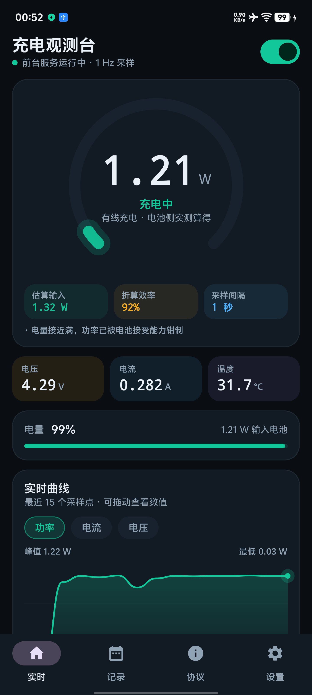
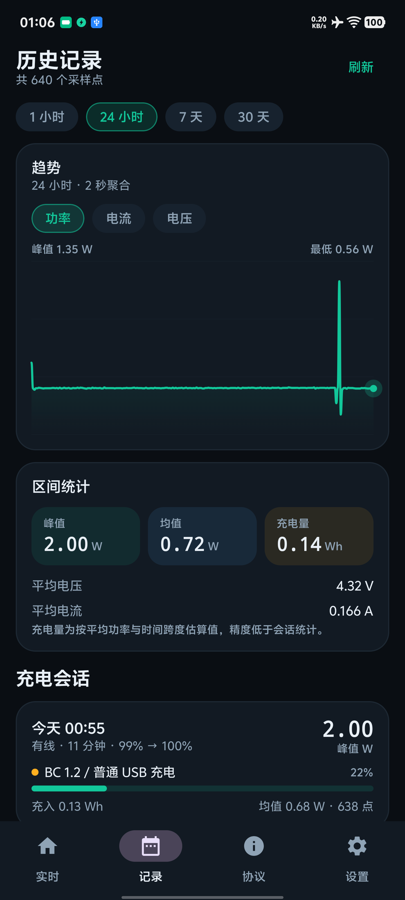
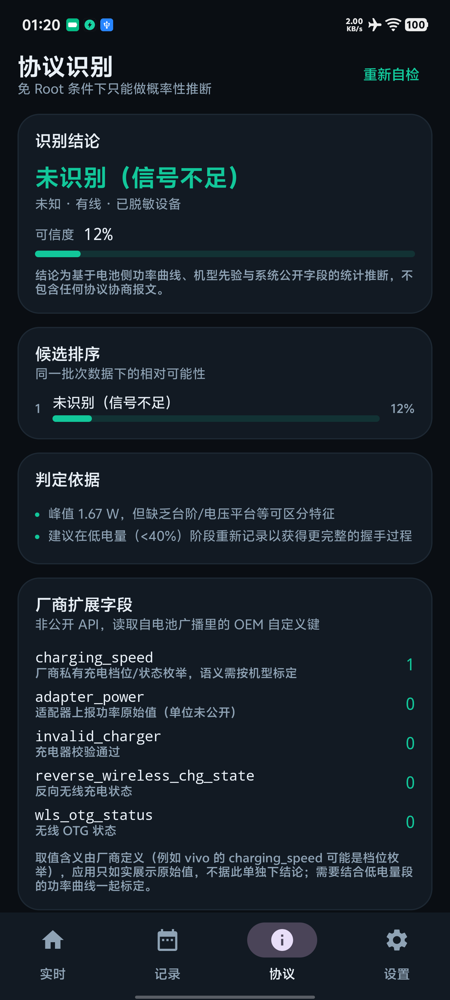

# 充电观测台 · ChargeLens

免 Root 的 Android 充电功率监测与充电协议推断应用。实时记录**电池侧**功率、电流、电压、温度与电量，
按时间序列归档并绘制趋势图，同时基于功率指纹给出**概率性**的充电协议推断。

> 一句话结论：免 Root 可以做到「准确的电池侧功率曲线 + 熄屏完整记录 + 协议族推断」，
> 但**读不到**充电器真实输出电压（VBUS）、USB PD 的 PDO/PPS 契约，或厂商私有协议的握手结果。
> 完整论证与两台真机的实测证据见 [docs/feasibility.md](docs/feasibility.md)。

<p align="center">
  
  
  
</p>

## 功能

| 模块 | 能力 |
| --- | --- |
| 实时监测 | 1 Hz 采样（可调 1/2/5 s），功率、电流、电压、温度、SOC、充放电状态、热状态 |
| 熄屏记录 | `specialUse` 前台服务 + `PARTIAL_WAKE_LOCK` + 看门狗闹钟，功率爬升阶段不丢点 |
| 时间序列 | SQLite（WAL）逐点落盘；自适应聚合（1 s ~ 2 h）绘制 1 小时 / 24 小时 / 7 天 / 30 天趋势 |
| 充电会话 | 插拔自动切分、30 s 增量落盘、进程被杀后续接、能量积分、断点标记 |
| 协议推断 | 小米、vivo、魅族、华为/荣耀、OPPO 系、三星、Pixel、Apple、摩托罗拉 + 公有协议 + 无线 |
| 厂商私有字段 | 读取并展示 OEM 自定义电池字段（vivo：`charging_speed` / `adapter_power` / `invalid_charger` / `cycle_count` 等） |
| 可观测性自检 | 逐项探测本机哪些字段与内核节点可读，把 SELinux 拒绝的结果直接展示出来 |
| 数据导出 | CSV（UTF-8 BOM，Excel 直接打开），含厂商字段原始值，可做离线分析/众包标定 |
| 隐私模式 | 一键隐藏机型与电池循环次数，截图/分享前不必再手动打码 |

## 构建与安装

环境：JDK 17、Android Studio Ladybug 或更新（AGP 8.7.3）、compileSdk 35、minSdk 26。

```bash
./gradlew :app:assembleDebug
adb install -r app/build/outputs/apk/debug/app-debug.apk
```

仓库已包含 Gradle Wrapper（8.9），无需本地安装 Gradle；`local.properties` 由 IDE 生成，
或手动写入 `sdk.dir=<Android SDK 路径>`。

### 在 vivo 机型上安装

实测 vivo（OriginOS / Android 16）会拦截 `adb install` 并返回
`INSTALL_FAILED_ABORTED: User rejected permissions`，需要同时满足：

1. 屏幕**点亮且已解锁**（`adb shell svc power stayon true` 可保持亮屏）；
2. 开发者选项里的「USB 安装」已允许（部分机型要求登录 vivo 账号）；
3. 用 `adb install -i com.android.vending` 指定安装器来源，可绕过系统的来源确认。

```bash
adb shell svc power stayon true
adb install -r -g -i com.android.vending app-debug.apk
```

## 使用建议

1. 首次启动授予通知权限；同意「电池优化白名单」。**仅这一步在 vivo 上不够**：还要到
   「设置 → 电池 → 后台耗电管理」把本应用改成「允许后台耗电」，否则熄屏数秒后进程会被冻结
   （设置页已提供该页面的直达入口）。小米 / OPPO 对应「应用智能省电」「耗电管理」。
   参考：自启动列表（i管家）只控制开机与关联拉起，不能阻止熄屏冻结。
2. 协议识别最有效的区间是**电量低于 40%**：插上充电器后记录 1–2 分钟，握手与功率爬升特征最明显。
3. 在设置里标注充电器型号，可显著提升同品牌档位的权重。
4. 历史页可切换 1 h / 24 h / 7 d / 30 d，聚合粒度会随数据跨度自动调整；长按/拖动图表查看数值。
5. 设置页「生成诊断报告」会把本机全部可读信号写入 `files/diag.txt`，便于反馈问题：
   `adb shell run-as com.chargelens cat files/diag.txt`

## 实测结果（真机验证）

| 设备 | 系统 | 结论 |
| --- | --- | --- |
| vivo 旗舰机型（型号已脱敏） | Android 16 / SDK 36 | 应用可运行；6 个厂商私有字段可用；sysfs 全被拒 |
| 另一台 vivo 机型（型号已脱敏） | Android 16 / SDK 36 | 存在 `vfcs-fchg`、`wls_rx` 等私有节点，但 shell 也被 SELinux 拒绝 |
| vivo V2454A | Android 17 / SDK 37 | 1 Hz 采样、会话、通知、CSV 导出、协议推断全部正常；`BatteryManager.isCharging` 返回 `false`（广播仍为 `plugged=1`/`status=2`）；熄屏需「允许后台耗电」才能连续记录 |

在实测机上读到的**可读信号**：

- 电池广播：电压、电流、温度、电量、`charge_counter`、`status`、`plugged`，以及
  `charging_speed`、`adapter_power`、`invalid_charger`、`reverse_wireless_chg_state`、
  `wls_otg_status`、`board_temp_status`、`cycle_count`、`soc_decimal`、`engine`
- `BatteryManager`：`getIntProperty` 的 1/2/4/6 号（库仑计 / 电流 / 电量 / 状态）、`getLongProperty`
- `PowerManager`：`ThermalStatus`、省电模式、Doze 状态

**不可读**（同一台设备、普通应用域）：

- `/sys/class/power_supply/*` 全部 `EACCES`，连目录列表都返回 `null`
- `UsbManager.getPorts()` → `SecurityException: requires android.permission.MANAGE_USB`
- `dumpsys battery` → `Can't find service: battery`（无 `DUMP` 权限）

### 熄屏冻结的实测证据（vivo V2454A / Android 17）

未放行「后台耗电管理」时，熄屏 90 秒只记录了 24 个点，`events` 表出现 `gap | 采样中断 87 秒`；
同一时刻 `dumpsys power` 显示唤醒锁已被平台禁用：

```
PARTIAL_WAKE_LOCK 'ChargeLens::sampler' DISABLED (uid=10384 isFrozen=true ...) mIsFrozen
```

把「设置 → 电池 → 后台耗电管理」改为「允许后台耗电」后复测：熄屏 64 秒采样 336 → 400，
1 Hz 连续、无新增 gap 事件、`isFrozen=false`。i管家 的「自启动」与 Doze 白名单**都不能**阻止该冻结，
只能靠厂商自己的耗电策略放行。

> 以上结果与应用内「协议 → 本机可观测性」页面显示一致，也与
> [docs/feasibility.md](docs/feasibility.md) 第 9 节的记录一致。

## 架构

```
app/src/main/java/com/chargelens/
├── core/        采样模型、BatteryManager 读取、电流单位自校准、格式化
├── data/        SQLite 时序存储、会话归档、聚合查询、设置
├── protocol/    协议知识库、特征提取与打分、可观测性自检
├── monitor/     前台服务、会话跟踪、开机自启、看门狗
├── diag/        全量信号诊断（DEBUG 启动自动生成）
└── ui/          Compose 界面：实时 / 记录 / 协议 / 设置
```

数据流：

```
BatteryManager + ACTION_BATTERY_CHANGED
        │  1 Hz（充电）/ 5 s（未充电）
        ▼
   BatterySampler ──► CurrentCalibrator（µA vs mA、符号）
        │
        ├──► SessionTracker ──► SQLite（samples / sessions / events）
        ├──► LiveRepository ──► Compose 实时页 / 通知
        └──► ProtocolEngine ──► 候选排序 + 可信度 + 证据链
```

## 关键实现

**功率为什么是「电池侧」的。** Android 只暴露电池端电压与电流，`P = V_batt × I_batt`。
它比适配器输出低 5–12%（充电 IC / 电荷泵损耗、系统负载分流），界面上的「估算输入」=
电池侧功率 ÷ 折算效率（默认 0.92，可调）。

**为什么要自己写采样循环。** `ACTION_BATTERY_CHANGED` 的投递频率由系统控制且随屏幕状态变化，
不能作为 1 Hz 数据源。应用在 `specialUse` 前台服务里用 Handler 定时读取，并在充电时持有
部分唤醒锁，才能完整记录熄屏后的功率爬升。

**电流单位自校准。** 文档规定 `CURRENT_NOW` 为 µA，但部分 OEM 内核实际填 mA。
应用对 `I·dt` 积分并与库仑计增量比较，比例落在 300–4000 时判定为 mA 并持久化系数。

**协议为什么只能推断。** 协商结果保存在充电 IC / PMIC 与内核 charger 驱动中，通过
`/sys/class/power_supply/*` 暴露，SELinux 对普通应用（甚至 `adb shell`）拒绝访问。
应用改从「结果侧」做特征匹配：峰值功率落在哪个档位、是否存在 >5 W 的功率台阶、
电池电流是否 >4 A 且功率 >35 W（电荷泵 + 双电芯特征）、系统是否上报协商电压上限、
以及厂商私有字段（如 `invalid_charger` 表示充电器未通过校验）。

## 可行性边界（摘要）

| 需求 | 免 Root | 说明 |
| --- | --- | --- |
| 电池侧功率 / 电流 / 电压 / 温度 | ✅ | 公开 API，精度取决于电量计 |
| 有线 / 无线判定 | ✅ | `EXTRA_PLUGGED` |
| 熄屏连续记录 | ✅ | 前台服务 + 唤醒锁；厂商冻结需手动白名单 |
| 协议族 / 功率档位推断 | ⚠️ | 概率性结论；中高 SOC 恒压段几乎不可区分 |
| VBUS / PDO / D+D- / 私有握手结果 | ❌ | 无公开 API，sysfs 受 SELinux 保护 |
| 充电器型号 / 无线线圈参数 | ❌ | 需 USB Host 模式或 Qi 芯片内部数据 |

各品牌私有协议的具体限制（小米 HyperCharge、vivo FlashCharge、魅族 mCharge、华为 SCP/FCP，
以及 OPPO/荣耀/三星/Pixel/Apple）详见 [docs/feasibility.md](docs/feasibility.md) 第 6 节。

## 已知限制

- 电池侧功率不等于适配器标称功率，也不等于墙端功率。
- 部分双电芯机型上报「单节电压 + 整包电流」，`V × I` 可能只有真实功率的一半（详见文档）。
- 恒压段（一般 SOC > 70%）功率被电池接受能力钳制，不同档位曲线高度重合，误判率上升。
- 无线充电只能判定「无线」与功率档位，无法读取频率、耦合或 Qi 版本。
- 部分机型 `CURRENT_NOW` 返回 0 或被屏蔽，此时只能依赖电压与功率台阶，可信度显著下降。
- 部分 ROM 的 `BatteryManager.isCharging` 与电池广播不一致（实测 vivo V2454A / Android 17 恒为
  `false`，而广播是 `plugged=1`、`status=2`）。应用只用广播判断插电状态，不依赖该 API。
- 国产 ROM 会在熄屏后**冻结**进程，此时平台把应用持有的 `PARTIAL_WAKE_LOCK` 置为 `DISABLED`，
  前台服务、唤醒锁、Doze 白名单都无法阻止，只能在厂商的「后台耗电管理」里放行（见使用建议第 1 条）。

## 测试

```bash
./gradlew :app:testDebugUnitTest
```

6 个 JVM 单元测试覆盖：功率换算、品牌隔离、vivo 双电芯电荷泵排序、小米 67 W 档位、
无线候选过滤、知识库一致性。

## 隐私

应用**未声明 `INTERNET` 权限**，不具备联网能力；所有数据保存在本机 SQLite，
CSV 导出由用户主动触发，不含任何账号或设备标识。

## 许可证

暂未指定。如需开源授权，请先补充 LICENSE 文件。
